# Understanding our recommender-system project

Our project asks how to recommend ten movies to each user, and what we gain or lose when we change the way those movies are chosen. It compares individual models, combinations of models, and rerankers that adjust an existing ranking. Accuracy is one outcome; variety, novelty, preference matching and the distribution of exposure reveal other aspects of the same recommendations.

Read the chapters in order on a first pass. The report defines the task and models before measuring them, then explains interventions before interpreting their results. Your work—independent metrics, calibration, item exposure and reranker evaluation—receives half the substantive coverage. The other half explains the shared foundations and your teammates' models, hybrids, diversification and group analysis.

<!-- ownership: shared:start -->
## 1. What the system predicts

<!-- role: opening -->
The system predicts an ordered list of movies from a user's observed interactions. An <strong>interaction</strong> is a recorded user–movie rating. A <strong>catalogue</strong> is the set of movies the system can recommend. A <strong>candidate</strong> is a movie eligible for a particular user's current recommendation. A model assigns a numerical <strong>score</strong> to each candidate; sorting those scores produces a <strong>ranking</strong>. Higher scores express a model's preference and need not be probabilities or predicted star ratings.

<!-- role: method -->
Three stages play different roles. A <strong>base model</strong> learns scores from interaction patterns. A <strong>hybrid</strong> combines information from models, such as scores, candidate lists or learned representations. A <strong>reranker</strong> selects and orders items from a supplied candidate pool using an additional objective. Keeping these stages separate lets us ask whether a change comes from learning better preferences, combining complementary signals or deliberately changing the final list's composition.

<figure class="report-figure" id="figure-1"><a href="figures/system-overview.svg">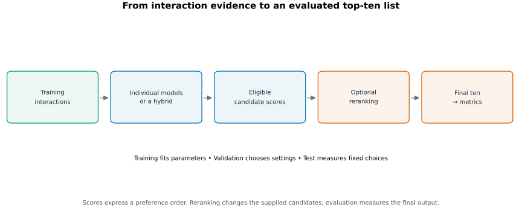</a></figure>

**Figure 1. The recommendation pipeline.** Follow the arrows from evidence to scores, then from candidates to the final list. The evaluation stage reads recommendations and held-out answers. The reranker reads permitted scores and context. This separation lets the same metric definitions compare outputs from different algorithms.

### The data and the prediction task

<!-- role: definition -->
MovieLens-100K contains 100,000 ratings from 943 users on 1,682 movies. The split randomly divides each user's history using seed 42: approximately 60% for training, 20% for validation and 20% for test. Per-user rounding gives 60,734 training interactions and 19,633 in each held-out partition. A <strong>partition</strong> is one of these disjoint subsets. <strong>Held-out</strong> means its outcomes are reserved from the model's fitting inputs.

<!-- role: method -->
The ranking task treats every held-out interaction as a relevant item, including low star ratings. This is an <strong>implicit-feedback</strong> interpretation: an observed interaction is positive evidence of interest. The weighted regression hybrid also uses the original 1–5 ratings as training targets, but ranking evaluation asks whether the movie was interacted with. These choices answer different questions without contradicting each other.

<!-- role: limitation -->
An unobserved user–movie pair has unknown relevance. Some learning algorithms sample such pairs as negatives to create a tractable training objective. That sampling does not establish that the user dislikes those movies. Likewise, a recommendation absent from the held-out set counts as a miss in offline evaluation even if the user might enjoy it. The measurements describe recovery of recorded interactions.

<!-- role: method -->
Before ranking, the system applies a <strong>history mask</strong>: it removes already observed movies from eligibility. Validation excludes training history; test excludes training plus validation history. Adding validation items to the test mask prevents recommending them again. It does not refit the model on those validation interactions. Most experiments score the full eligible catalogue, a policy called <strong>full-sort evaluation</strong>.

<!-- role: limitation -->
The random split measures held-out interaction recovery, rather than future prediction in chronological order. A temporal evaluation would train on earlier events and test on later ones. It could reveal a different ordering of models, but it would be a different experiment. Results on this split should therefore be interpreted within its random-holdout task.

### Training, selection and measurement

<!-- role: definition -->
<strong>Training</strong> fits model parameters. <strong>Validation</strong> chooses settings, such as regularization strength, a training checkpoint or a reranking strength. <strong>Test</strong> measures the choices after they have been fixed. A <strong>hyperparameter</strong> controls the learning procedure rather than being fitted directly from its training objective. A <strong>checkpoint</strong> stores a fitted model at a particular training stage.

<!-- role: method -->
The primary selection measure is normalized discounted cumulative gain at ten, <strong>NDCG@10</strong>. It rewards relevant movies near the beginning of the list and scales performance against an ideal ordering. Chapter 3 gives its exact formula. Using one selection measure prevents each model from choosing the metric that makes it look strongest. Other metrics remain necessary to understand what that selection favors.

<!-- role: advantage -->
A fair comparison holds the task constant: the users, candidate policy, relevant items, list length and aggregation rule. A <strong>control</strong> is the matched system used to isolate a particular change. For example, a reranker's control is the same model's original ranking on the same eligible candidates. Comparing against a differently trained model would mix several effects.

<!-- role: method -->
The code expresses these boundaries through three shared objects. <code>ScoreTable</code> maps external user IDs to eligible item scores and identifies the evaluation partition. <code>Rankings</code> maps each user to an ordered list of item IDs. <code>RerankContext</code> carries training-derived profiles, counts and prepared metadata. External IDs identify the same real users and movies across modules; framework-internal array indices are converted at the boundary.

<!-- role: advantage -->
The module structure follows the same separation. RecBole supplies model training and prediction. <code>project/recsys/recbole_adapter.py</code> connects those models to the shared data and score format. The metrics, rerankers and hybrid modules implement the experimental decisions discussed below. A common evaluation writer calls the independent metric functions for every supplied ranking, so a hybrid and a reranker receive the same definitions of success.

## 2. How the individual models produce scores

<!-- role: opening -->
The individual models use different assumptions about how interaction patterns reveal preference. Let <code>X[u,i]</code> be one when user <code>u</code> interacted with movie <code>i</code> in training, and zero otherwise. This user–item matrix is sparse: most entries are unobserved. <strong>Collaborative filtering</strong> uses patterns across users and items in this matrix, rather than relying solely on movie descriptions.

### Neighborhood models

<!-- role: method -->
<strong>ItemKNN</strong> recommends movies similar to those in a user's training history. It estimates similarity between item interaction columns, keeps a neighborhood of useful neighbors and aggregates their support for a candidate. <strong>UserKNN</strong> starts from similar users and recommends movies supported by their histories. KNN means k-nearest neighbors; its neighborhood size is a model setting and differs from the final recommendation length of ten.

<!-- role: advantage -->
Neighborhood models make a concrete assumption: shared interaction patterns contain reusable preference information. Their appeal is a direct link between evidence and score. Their weakness is sparse support: a similarity based on very few common observations may be unreliable. Shrinkage reduces the influence of weak similarity evidence, while the neighborhood limit controls how much distant evidence contributes.

<!-- role: method -->
This repository implements both variants through the <code>ItemKNN</code> class, selected by <code>knn_method: item</code> or <code>user</code>. The configuration label therefore carries meaning that the Python class name alone cannot convey. A comparison must keep ItemKNN and UserKNN distinct even though they share implementation machinery.

### Pairwise and linear models

<!-- role: definition -->
<strong>BPR</strong>, Bayesian Personalized Ranking, learns an embedding, or numerical vector, for each user and item. Their dot product is the score. Training samples an observed item and an unobserved item for the same user, then encourages the observed item to score higher. A <strong>pairwise loss</strong> learns an ordering from such comparisons. It differs from predicting an exact rating and from directly maximizing top-ten NDCG.

<!-- role: tradeoff -->
BPR's learned vectors can generalize beyond an explicitly chosen neighborhood. Their quality depends on embedding size, regularization, sampling, learning rate and training duration. More dimensions offer more capacity but can fit noise. More training can improve the objective while harming held-out ranking, which motivates validation-based checkpoint selection.

<!-- role: method -->
<strong>EASE</strong> learns a linear item-to-item coefficient matrix. A user's interaction vector multiplied by that matrix produces scores. Its objective reconstructs observed interactions while penalizing large coefficients. The diagonal is fixed at zero, so an item cannot explain itself by copying its own input. The regularized problem has a closed-form solution, which makes fitting quite different from an epoch-by-epoch neural model.

<!-- role: method -->
<strong>SLIMElastic</strong> also reconstructs item interactions, but fits a separate elastic-net regression for each target movie. The L1 penalty encourages many coefficients to become zero; the L2 penalty shrinks their magnitude. The project's configuration also constrains coefficients to be nonnegative. Hiding the target item's input prevents self-copying. Sparse coefficients can retain a compact set of useful relationships, at the cost of solving many optimization problems.

<!-- role: tradeoff -->
Regularization controls the balance between fitting observations and limiting complexity. Too little can overfit sparse co-occurrences; too much can remove useful signal. SLIM's solver also needs enough iterations to converge. An unconverged configuration confounds model choice with incomplete optimization, so convergence belongs to a meaningful comparison.

<figure class="report-figure" id="figure-2"><a href="figures/individual-tuning.svg">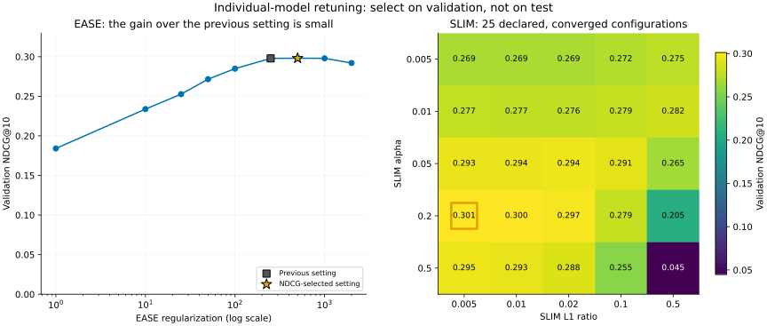</a></figure>

**Figure 2. Regularization has an operating range.** The EASE horizontal axis is logarithmic; the SLIM heatmap contains 25 discrete settings. The selected EASE setting improves validation NDCG only slightly over 250: approximately 0.298099 versus 0.297866. SLIM selects alpha 0.2 and L1 ratio 0.005. The tested grids support these choices within their search ranges, rather than a claim of global optimality.

### Learning an item-based user representation

<!-- role: method -->
<strong>FISM</strong>, the Factored Item Similarity Model, learns two embeddings per movie: one for contributing to a user's history representation and another for scoring a target. It sums the source embeddings in the user's history, scales that sum by history length raised to a negative exponent and compares it with the target embedding. Bias terms add user- and item-specific offsets.

<!-- role: reasoning -->
The history-length exponent controls how strongly a large history increases the representation's magnitude. With no normalization, more observations can create a larger sum simply because there are more terms. Stronger normalization reduces that effect. FISM therefore represents a user's evidence through their interacted items instead of assigning the user an independent free embedding, as BPR does.

<!-- role: method -->
The target movie is excluded from its own history contribution, including its contribution to the normalization count. Otherwise, training could score an observed target using that target's own source vector. The implementation applies this rule consistently in individual-item scoring and full-catalogue scoring.

<!-- role: definition -->
FISM's training output is a <strong>logit</strong>: an unrestricted score transformed by the logistic sigmoid when computing binary cross-entropy. <code>BCEWithLogitsLoss</code> combines these operations internally for numerical stability, so it receives raw logits. Applying sigmoid beforehand would change the intended objective. This distinction concerns the meaning of the model output, rather than whether a ranking score must resemble a probability.
<!-- ownership: shared:end -->

<!-- ownership: jacek:start -->
## 3. Your metric layer: what a good ranking means

<!-- role: opening -->
Your independent metric layer turns a ranking into several precise measurements. “Independent” means these calculations are implemented in the project rather than accepted only from the training framework's summary. The purpose is a stable evaluation definition across individual, hybrid and reranked outputs. It also makes small examples easy to inspect by hand.

<figure class="report-figure" id="figure-3"><a href="figures/evaluation-flow.svg">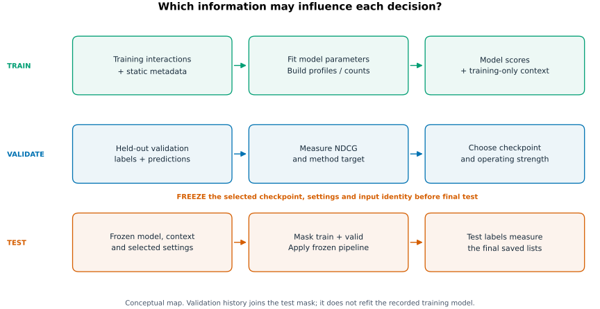</a></figure>

**Figure 3. Each stage may use different information.** Training observations build the model and reranker context. Validation outcomes select settings. Test outcomes measure fixed choices. A profile calculated from test interactions would supply answers to the recommendation algorithm; calculating a metric from those interactions is the intended evaluation.

### Accuracy: six questions about relevant items

<!-- role: definition -->
For one user, let <code>K</code> be the list length, <code>R</code> the number of held-out relevant items and <code>H</code> the number found in the top K. A <strong>hit</strong> is a recommended item in that user's relevant set. The code requires K distinct recommendations, a nonempty relevant set and matching evaluation users. These requirements make the denominators and the evaluated population explicit.

**Table 1. The six per-user accuracy metrics. All are higher-is-better.**

| Metric | Implemented definition | Question |
| --- | --- | --- |
| Precision@K | H/K | What fraction of recommendations are relevant? |
| Recall@K | H/R | What fraction of relevant items are recovered? |
| F1@K | 2 × precision × recall / (precision + recall), or zero without hits | How well are precision and recall balanced for this user? |
| MRR@K | Reciprocal of the first hit's rank, or zero | How early is the first useful result? |
| NDCG@K | Discounted hit gain divided by ideal discounted gain | How close is the ordering to the best attainable top-K ordering? |
| AP@K | Sum of precision at each hit position, divided by R | Are the hits concentrated near the top while recovering the relevant set? |

<!-- role: definition -->
<strong>MRR</strong> means mean reciprocal rank after averaging users. For a first hit at rank four, the user's reciprocal rank is 1/4; later hits do not change it. <strong>Discounted cumulative gain</strong>, DCG, adds <code>1/log2(r+1)</code> for a hit at rank <code>r</code>. NDCG divides DCG by the sum for an ideal list with hits in its first <code>min(K,R)</code> positions.

<!-- role: method -->
The project divides average precision by the full relevant-set size R. This choice matters because some definitions use <code>min(K,R)</code>. In the output, the per-user field is called <code>MAP@K</code>, and its average is mean average precision. Reading the implementation prevents a familiar metric name from hiding a different denominator.

<figure class="report-figure" id="figure-4"><a href="figures/accuracy-example.svg">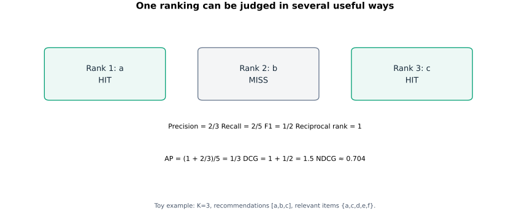</a></figure>

**Figure 4. One ranking, different judgments.** For ranking [a,b,c] and relevant set {a,c,d,e,f}, precision is 2/3, recall is 2/5 and reciprocal rank is 1. Average precision is <code>(1 + 2/3)/5 = 1/3</code>. NDCG is approximately 0.704: the first hit is ideal, but the missing rank-two hit reduces discounted gain. The metrics reward different properties of the same list.

<!-- role: method -->
The aggregate accuracy metrics are <strong>macro averages</strong>: each user contributes one value with equal weight. A user with many held-out interactions does not receive more weight simply for having more observations. This makes the typical evaluated user the unit of comparison, rather than the typical interaction.

<!-- role: reasoning -->
Calculate F1 per user before averaging. Suppose one user has precision 1 and recall 0.2, while another has precision 0.2 and recall 1. Each F1 is 1/3, so mean F1 is 1/3. Applying the F1 formula to mean precision and recall, both 0.6, gives 0.6 and answers a different question. Similar care is needed whenever aggregation follows a nonlinear formula.

### Why metric denominators change the interpretation

<!-- role: reasoning -->
The maximum attainable recall at a fixed K depends on the relevant-set size. If a user has fifty relevant movies and receives ten recommendations, even ten hits give recall 0.2. Another user with five relevant movies can reach recall one. The full-set AP denominator creates a related limit: when R exceeds K, even an ideal top-K list cannot achieve AP one. This is an intended consequence of rewarding recovery of the whole relevant set.

<!-- role: reasoning -->
NDCG answers a different question by normalizing against the best ordering possible within K positions. It can reach one for both users when every attainable top position is a hit. MRR can also reach one after a single first-position hit, regardless of how many other relevant items remain. Comparing several metrics therefore distinguishes early usefulness, list accuracy and completeness of recovery.

<!-- role: limitation -->
These differences matter when comparing activity cohorts. Users with different history lengths often have different held-out set sizes. A gap in recall can partly reflect its denominator, while a gap in NDCG describes performance relative to each user's ideal ranking. Neither metric removes every difference in prediction difficulty. Report the definition and cohort sizes before treating a group gap as evidence about a model's treatment of that group.

### Variety, novelty and matching a user's preferences

<!-- role: definition -->
<strong>Intra-list diversity</strong>, ILD, measures genre variety among the recommended movies. For genre sets A and B, Jaccard distance is <code>1 − |A ∩ B|/|A ∪ B|</code>. ILD averages this distance over unordered pairs. A ten-item list has 45 pairs. Identical genre sets have distance zero; disjoint sets have distance one. ILD is undefined for a one-item list.

<!-- role: definition -->
<strong>Novelty</strong> uses a movie's rarity in training as a proxy for how unfamiliar it might be. Mean self-information averages <code>−log2((count_i+1)/(N+M))</code>, where N is the total number of training interactions and M is catalogue size. Adding one is <strong>Laplace smoothing</strong>; it gives a finite value to movies with zero training interactions. Larger values indicate lower training popularity.

<!-- role: limitation -->
This novelty measure describes population-level rarity, rather than a particular user's knowledge. A rare movie may be familiar to a specialist, while a popular movie may be new to another user. Genre diversity is different again: a varied list can contain only famous movies. The two metrics should therefore retain separate names and interpretations.

<!-- role: definition -->
<strong>Calibration</strong> measures whether the list's category proportions match the user's training preferences. Let <code>p</code> be the historical distribution and <code>q</code> the recommendation distribution. Genre miscalibration is <code>KL(p || 0.99q + 0.01p)</code>, using natural logarithms. Kullback–Leibler divergence, KL, penalizes assigning too little recommendation mass to categories represented in the profile. The mixture gives those categories positive mass and avoids infinite penalties.

<!-- role: definition -->
<strong>User popularity deviation</strong>, UPD, applies the same matching idea to head, middle and tail popularity bands. It uses base-two Jensen–Shannon divergence between the training and recommendation distributions. Jensen–Shannon divergence compares each distribution with their midpoint; it is symmetric and bounded. The implementation uses the divergence itself, without taking its square root. Lower genre KL and lower UPD mean closer matching under their respective definitions.

<!-- role: reasoning -->
Matching a popular-history user with another popular list can produce low UPD. Promoting tail items may increase novelty while increasing that user's deviation. Calibration therefore preserves a historical preference distribution; novelty favors rare items. This distinction explains why two reasonable objectives can recommend different movies to the same user.

<!-- role: reasoning -->
The direction and units of a divergence belong to its definition. Genre KL weights category penalties by the user's historical profile, so reversing its arguments would create another measurement. Jensen–Shannon divergence uses the midpoint of both distributions and gives a symmetric comparison. Smoothing makes genre KL finite when a list omits a historically observed genre, but it does not remove the penalty for that omission.

<!-- role: tradeoff -->
Changing logarithm base rescales a divergence. That rescaling preserves its ordering as a standalone metric, yet changes its numerical balance against relevance inside a fixed-strength objective. A strength selected for natural-log KL cannot automatically be interpreted as equivalent to the same strength for base-two JS. The validation rule measures the consequence of the particular implemented definitions.

### Reach, exposure and group differences

<!-- role: definition -->
<strong>Catalogue coverage</strong> is the fraction of catalogue items appearing at least once across the supplied users' lists. It measures breadth over a <strong>cohort</strong>, the collection of users evaluated together. With 943 users and ten recommendations each, the union of recommended items can be much larger than ten. Repeated appearances of an already covered item add no further coverage.

<!-- role: definition -->
<strong>Exposure</strong> assigns more visibility to high ranks. Each appearance at rank r adds <code>1/log2(r+1)</code> to that movie's exposure. <strong>Exposure Gini</strong> measures inequality across all catalogue movies, including those with zero exposure. For sorted exposures <code>e_1 ≤ … ≤ e_M</code>, the code's Gini is <code>Σ(2j−M−1)e_j / (M Σe_j)</code>. Zero indicates equality; larger values indicate concentration.

<!-- role: reasoning -->
Coverage and Gini answer different questions. Exposures [3,1,0,0] give coverage 2/4 and Gini 0.625. Introducing a previously unseen movie can raise coverage without spreading the remaining exposure evenly. Excluding zero-exposure movies from Gini would remove part of the inequality being measured, so the catalogue denominator must remain explicit.

<!-- role: method -->
Item-group exposure summarizes head, middle and tail through total exposure, share of all exposure and exposure per item. Equal total exposure for two differently sized groups does not imply equal exposure per movie. The tail has far more movies than the head, so these two fairness targets would produce very different allocation policies.

<!-- role: definition -->
The project's recorded-gender diagnostic compares mean accuracy for F and M users. It reports absolute gaps and signed F-minus-M gaps, plus group counts. For NDCG, the absolute gap is <code>|mean_F − mean_M|</code>. Unknown recorded values remain explicit. This is a dataset-specific group diagnostic; it neither captures every dimension of user fairness nor demonstrates a fairness intervention.

<!-- role: limitation -->
A smaller gap can occur because the higher-performing group becomes worse. Both groups can also receive equally poor recommendations. Interpret the gap alongside each group's absolute quality and size. Item exposure inequality and user quality gaps concern different recipients—movies and people—and an improvement in one need not improve the other.

### Availability and the evaluation interface

<!-- role: method -->
The main entrypoints are <code>metrics/accuracy.py:evaluate_accuracy</code> and <code>metrics/beyond_accuracy.py:evaluate_beyond_accuracy</code>. The first returns per-user accuracy and macro means. The second computes per-user measures where appropriate, cohort statistics where necessary and explicit availability information. The shared writer calls both for supplied rankings, so reranking cannot quietly substitute easier metric definitions.

<!-- role: reasoning -->
Invalid rankings and unavailable measurements require different responses. Duplicate recommendations, missing evaluation users or invalid scores undermine the experiment and should stop it. Missing genre metadata can make a genre-dependent measurement unavailable. Returning zero instead would imply a meaningful numerical outcome, such as perfect calibration, where none was established.

<!-- role: method -->
Coverage and Gini must be recomputed on the cohort being described. Averaging two subgroup Ginis does not recover the full-population Gini. Likewise, averaging subgroup coverage double-counts movies appearing in both groups. Per-user means and pooled catalogue statistics require different aggregation procedures because their units of analysis differ.
<!-- ownership: jacek:end -->

<!-- ownership: shared:start -->
## 4. What the baselines establish

<!-- role: opening -->
Random and Popularity provide two useful reference behaviors. Random ignores learned preference and gives each user–item pair an independent random score. Popularity assigns scores from actual training item frequencies. All users share its underlying item ordering, but their history masks can leave different eligible lists.

<!-- role: reasoning -->
Popularity counts each real training interaction once. It does not estimate frequency from how often a training loader happens to expose an item, and sampled negatives contribute no popularity evidence. Dividing counts by the maximum count rescales the score without changing the ranking. Random needs separate draws across users; repeating one score vector would artificially couple their recommendations.

**Table 2. Eight-model comparison under the supplied individual configurations. Coverage is the fraction of the 1,682-item catalogue reached by the cohort.**

| Model | Test NDCG@10 ↑ | Coverage ↑ | Exposure Gini ↓ |
| --- | ---: | ---: | ---: |
| Random | 0.014494 | 99.58% | 0.269797 |
| Popularity | 0.211725 | 2.91% | 0.990920 |
| ItemKNN | 0.363396 | 11.59% | 0.966588 |
| UserKNN | 0.368656 | 10.11% | 0.968856 |
| BPR | 0.354497 | 26.99% | 0.934923 |
| SLIMElastic | 0.403266 | 18.49% | 0.946017 |
| EASE | 0.404872 | 17.42% | 0.950662 |
| FISM | 0.348765 | 37.63% | 0.909388 |

<figure class="report-figure" id="figure-5"><a href="figures/baseline-comparison.svg">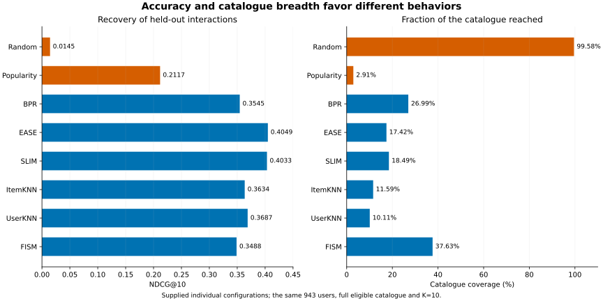</a></figure>

**Figure 5. High reach is easy to obtain without useful personalization.** Random reaches 1,675 movies but has very low NDCG. Popularity is much more accurate while concentrating almost all exposure on a small catalogue subset. EASE and SLIM achieve the strongest NDCG in this comparison, yet their coverage remains much lower than Random's. The panels use different units; a long coverage bar does not compensate numerically for an accuracy loss.

<!-- role: interpretation -->
The personalized models outperform Popularity on NDCG under this setting. This supports the value of user-specific interaction patterns, but the best model depends on the property valued. FISM covers more of the catalogue than EASE here, while EASE ranks recorded positives more accurately. Treating accuracy, coverage and inequality as separate outcomes makes that trade-off visible.

<!-- role: limitation -->
These rows are a matched comparison of the supplied configurations, not a universal ranking of model families. The tuned reranking study uses its own fitted controls, including different BPR and FISM settings. Compare an intervention with its own original model; using a similarly named row from another configuration would mix model fitting with post-processing.

<!-- role: limitation -->
The differences between Random and Popularity also show why an attractive diagnostic cannot serve alone as a quality objective. Random's small F/M gap can coexist with very poor accuracy for both groups. Popularity's high genre ILD can coexist with recommending only head movies. The project needs a collection of measurements because each omits properties that another reveals.
<!-- ownership: shared:end -->

<!-- ownership: jacek:start -->
## 5. Building the context your rerankers use

<!-- role: opening -->
Rerankers need a description of preferences and exposure that can be calculated before seeing the held-out answers. The project constructs histories, item counts, genre profiles and popularity profiles from training interactions. Static movie genres and recorded user metadata supply category labels. The distinction is between known attributes and preferences estimated from outcomes.

### Genre and popularity profiles

<!-- role: method -->
A multi-genre movie contributes one total unit of genre mass. A movie labeled Action and Comedy contributes one half to each category. Summing these contributions over a user's training history and normalizing gives their genre profile. The recommendation distribution uses the same rule, so historical and recommended proportions are comparable.

<!-- role: reasoning -->
Fractional weighting prevents a four-genre movie from counting as four times as much evidence as a one-genre movie. It also fixes the meaning of calibration: the profile represents normalized movie-level genre mass. A diagnostic that counts every genre membership once may be useful for another purpose, but its denominator differs.

<!-- role: method -->
Popularity bands describe cumulative training-interaction shares. Sort catalogue movies by training count and assign complete count-tie buckets to head, middle or tail around cumulative boundaries of 20% and 80%. Keeping ties together avoids assigning equally frequent movies to different bands merely because of item order. A bucket can cross a boundary, so realized shares need not equal 20/60/20 exactly.

<figure class="report-figure" id="figure-6"><a href="figures/training-popularity.svg">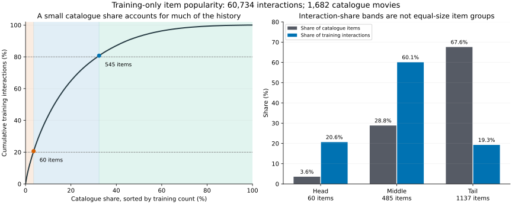</a></figure>

**Figure 6. Popularity bands have very different catalogue sizes.** The 60 head movies form 3.6% of the catalogue but account for 20.6% of training interactions. The 485 middle movies account for 60.1% of interactions. The tail contains 1,137 movies—67.6% of the catalogue—but 19.3% of interactions. The left curve shows the concentration; the right panel makes the denominator difference explicit.

<!-- role: interpretation -->
The popularity structure explains why head-focused recommendation can perform well on observed interactions while offering little catalogue reach. It also explains why equal exposure per movie differs from equal total exposure per band. A policy that gives the head and tail the same total exposure divides the tail allocation among many more items.

<!-- role: method -->
Each user's popularity profile is the fraction of their training interactions in the three bands. The recommendation profile is the corresponding fraction of recommended items. These are unweighted occurrence distributions for UPD. Exposure summaries instead discount rank, so a head share computed from visibility is a different quantity from a head share used in calibration.

<!-- role: example -->
A small profile makes the weighting concrete. Suppose a user interacted with one Action/Comedy movie and one Drama movie. Their genre mass is 0.5 Action, 0.5 Comedy and 1 Drama; dividing by the two movies gives profile (0.25,0.25,0.50). A recommendation list uses the same fractional calculation. Counting both labels as full observations would instead give three membership units and change what “matching the profile” means.

<!-- role: reasoning -->
Training support and catalogue knowledge also differ. A movie can have known genre metadata but zero training interactions. It can enter the catalogue, receive finite smoothed novelty and contribute its genres if recommended. Its collaborative score may still be weak because the model has little behavioral evidence. Knowing the item's identity and attributes does not by itself solve the problem of predicting which users would want it.

### Information boundaries and metadata

<!-- role: reasoning -->
Validation and test interactions measure how the system behaves on unseen outcomes. Using them to construct a profile would teach the reranker what it is supposed to discover. The user can have different validation and test candidate masks while retaining the same training-derived profile. Masking known history and fitting preferences are separate operations.

<!-- role: method -->
The context is prepared in <code>data.py</code> and passed through <code>RerankContext</code>. Genre calibration reads user profiles and candidate genres. Popularity calibration reads user popularity profiles and item bands. Novelty reads full-catalogue training counts. Exposure allocation can use its running exposure state without reading genre or recorded-gender attributes. The common interface permits different objectives without making their information requirements identical.

<!-- role: limitation -->
Required metadata is checked for the supplied cohort and candidates. Removing difficult users or items after seeing missing inputs would change the population being evaluated. The system instead makes unavailability explicit. A comparison over a metadata-complete subset must identify that subset rather than being interpreted as a full-cohort result.

## 6. Your reranking methods: change the list deliberately

<!-- role: opening -->
A reranker chooses ten items from a model's top fifty eligible candidates. It can reorder or replace items within that pool, but it cannot recover a useful movie the model excluded from the pool. Candidate depth therefore limits attainable accuracy, calibration and reach before the reranker's objective is considered.

<!-- role: reasoning -->
The candidate pool limits what the reranker may recommend; it does not redefine which held-out items count as relevant. If a relevant movie lies outside the top fifty, the reranker cannot hit it, but it remains in the recall and average-precision denominators. Removing it would reward a restrictive retriever by making its task easier. This is why the evaluation layer receives the full relevant set separately from the score table supplied to the reranker. A candidate mask represents recommendation eligibility; a relevance set represents the outcomes against which the final recommendation is judged.

### A common relevance scale

<!-- role: method -->
The rerankers min-max normalize model scores separately within each user's pool: <code>normalized_i = (score_i − minimum)/(maximum − minimum)</code>. Constant score vectors map to zero. This places the relevance term between zero and one, allowing one strength parameter to combine it with another objective despite different models' raw score ranges.

<!-- role: tradeoff -->
Normalization removes arbitrary location and scale, but it does not make all target metrics equally important at the same strength. A unit of genre KL has a different meaning from a unit of popularity JS or an exposure bonus. The strength λ is an empirical trade-off parameter, and each model/method pair needs its own validation choice.

<!-- role: method -->
At λ=0, every implemented method returns the original top ten exactly. At positive strengths, ties use the original score and then the external item ID. These decisions create a clear control and reproducible tie handling. Equality at zero means that merely invoking the reranker does not introduce another algorithmic change.

### Greedy genre and popularity calibration

<!-- role: definition -->
A <strong>greedy algorithm</strong> chooses the best available next item under its current objective, commits to it and continues. Calibration constructs a list this way. For each remaining candidate, it forms the category distribution of the growing list after that candidate is appended. It chooses the candidate maximizing <code>(1−λ) × normalized relevance − λ × mismatch</code>.

<!-- role: reasoning -->
Mismatch is smoothed genre KL for genre calibration and popularity JS for popularity calibration. The whole growing distribution matters. A drama can be attractive early, then less useful when the list already contains too much drama relative to the user's profile. This is a property of the list, rather than a fixed independent reward attached to every item.

<figure class="report-figure" id="figure-7"><a href="figures/calibration-step.svg">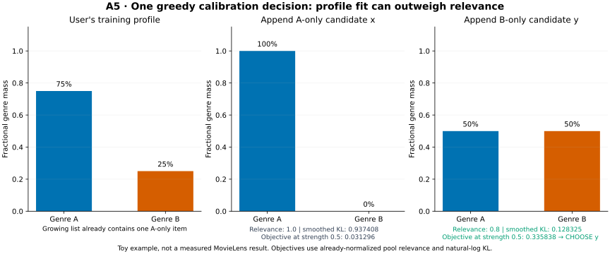</a></figure>

**Figure 7. A worked calibration decision.** The user's profile is p=(0.75 A,0.25 B), and the list already contains one A-only movie. Candidate x is A-only with normalized relevance 1.0; candidate y is B-only with relevance 0.8. Appending them gives distributions (1,0) and (0.5,0.5). After profile smoothing, KL is approximately 0.937408 for x and 0.128325 for y.

<!-- role: method -->
At λ=0.5, x's objective is <code>0.5×1 − 0.5×0.937408 = 0.031296</code>. Candidate y's is <code>0.5×0.8 − 0.5×0.128325 = 0.335838</code>. The algorithm chooses y because its improvement in profile matching outweighs its lower model relevance. Those relevance values are already normalized within the full pool; renormalizing only the two illustrated candidates would change the calculation.

<!-- role: tradeoff -->
Greedy construction is tractable because it compares remaining candidates at each of ten steps, rather than enumerating all ordered ten-item subsets. Its cost grows with users, list length, pool size and category calculations. The price of that efficiency is a local decision rule: it provides no guarantee of a globally optimal completed list.

<!-- role: limitation -->
Even λ=1 cannot make arbitrary proportions attainable. The candidate pool may lack a genre, and ten discrete movie choices may only approximate the desired distribution. Calibration also preserves a historical preference pattern that may reflect earlier exposure constraints. Lower divergence establishes closer matching, rather than proving that the historical pattern is ideal for the user.

### Allocating exposure across users

<!-- role: method -->
Item-exposure reranking maintains a shared exposure counter for all users in one call. At each choice it maximizes <code>(1−λ) × normalized relevance + λ/(1+item exposure)</code>. The reciprocal bonus favors items with less accumulated visibility. After choosing an item at rank r, it adds <code>1/log2(r+1)</code> to that item's counter.

<!-- role: reasoning -->
The algorithm operates in rank rounds: each user gets a first-position choice before any user gets a second-position choice. Within a round it visits users in sorted external-ID order. This limits the opportunity for one user to consume many low-exposure items before others receive a first recommendation. Sorting strings gives lexical order, which can place “10” before “2”.

<figure class="report-figure" id="figure-8"><a href="figures/exposure-round.svg">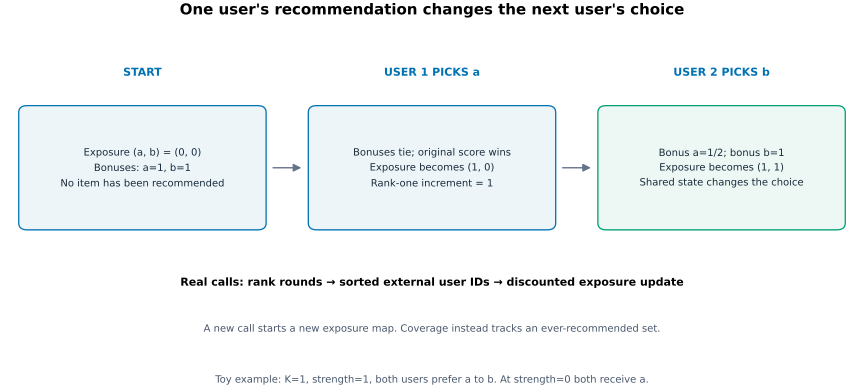</a></figure>

**Figure 8. Shared state changes the next user's answer.** Let both users prefer a over b, K=1 and λ=1. Initially both bonuses are one, so the original-score tie-break gives a to user 1. Exposure becomes (1,0). User 2 now sees bonuses 1/2 for a and 1 for b, so receives b. At λ=0, both users receive a.

<!-- role: method -->
Exposure state resets for every experiment call. Otherwise, the result for a model could depend on which model or strength happened to run earlier. The counter is a simulated allocation over the evaluated cohort, rather than a persistent record of real-world impressions.

<!-- role: limitation -->
The inverse-exposure bonus is a heuristic, not the exact marginal decrease in catalogue Gini. Gini measures the resulting lists and helps select a strength; it is not the greedy item's objective itself. The method can reduce concentration without achieving equality, minimum possible Gini or a specified allocation across popularity bands.

<!-- role: reasoning -->
This cohort dependence differs from calibration. Changing another user's candidates can affect exposure choices even when the first user's scores remain fixed. A different cohort or traversal order can therefore change an individual's result. The shared-state mechanism explains the pipeline-order experiment in chapter 9.

### What the evaluation cohort means for allocation

<!-- role: reasoning -->
For a local calibration method, evaluating another user does not change the first user's list. For exposure allocation, the cohort is part of the algorithm's effective input. Splitting 943 users into independent batches resets counters more often and can produce different recommendations from processing all 943 together. Equal model scores and equal strength are insufficient to establish equivalent experiments when the state boundary changes.

<!-- role: tradeoff -->
The chosen traversal policy makes allocation deterministic and easy to inspect. It also gives earlier users a different state from later users within each round. Randomizing user order could test sensitivity, but would introduce another source of variability. Persisting exposure across calls could model a continuing service, but would require specifying its starting state and update policy. The reported experiment instead measures a fresh allocation over one fixed cohort.

<!-- role: limitation -->
Discounted exposure is a model of visibility, not measured attention. The logarithmic rule assumes that later positions receive less weight in a particular way. Real users may browse differently, and an impression may not imply that an item was noticed. Gini results are therefore conditional on this visibility rule as well as the catalogue, cohort and recommendation lists.

### Integration choices that affect the experiment

<!-- role: method -->
The implementation contract is <code>rerank(scores, context, k, strength) → rankings</code>. Shared helpers validate the pool, strength and scores before an objective constructs its output. Calibration and exposure live in separate modules under <code>rerankers/</code>. The experiment runner associates each method with a target metric and an optimization direction, keeping algorithm construction separate from measurement and strength selection.

<!-- role: reasoning -->
Direction matters: genre mismatch, UPD and Exposure Gini are minimized; ILD, novelty and coverage are maximized. A direction error could choose a mathematically valid setting that worsens the intended objective. Keeping direction in the method definition makes the selection rule explicit without pretending that all targets share one numerical scale.

<!-- role: tradeoff -->
Top fifty and the five-percent accuracy budget are experimental choices, rather than requirements derived from the metric formulas. A larger pool gives the reranker more alternatives and increases computation. A tighter loss budget preserves more ranking accuracy but may force weak or zero intervention. The experiment studies one controlled operating policy, leaving those sensitivity questions open.

## 7. Evaluating your rerankers and interpreting the costs

### Choose an operating point before testing

<!-- role: method -->
For each model and method, the runner evaluates λ in {0,0.25,0.5,0.75,1} on validation. A setting is feasible when its NDCG is at least 95% of that model's original validation NDCG. Among feasible settings, it chooses the best method-specific target, breaking ties by higher NDCG and then lower strength. The selected strength is fixed before test measurement.

<!-- role: example -->
If original validation NDCG is 0.300, the threshold is 0.285. Suppose strengths 0.25, 0.5 and 0.75 produce NDCG 0.292, 0.286 and 0.282 while reducing mismatch progressively. Strength 0.75 is infeasible; 0.5 wins among the remaining settings if it has the lowest mismatch. The rule optimizes a target subject to an accuracy constraint, rather than choosing the largest strength automatically.

<figure class="report-figure" id="figure-9"><a href="figures/validation-tradeoffs.png">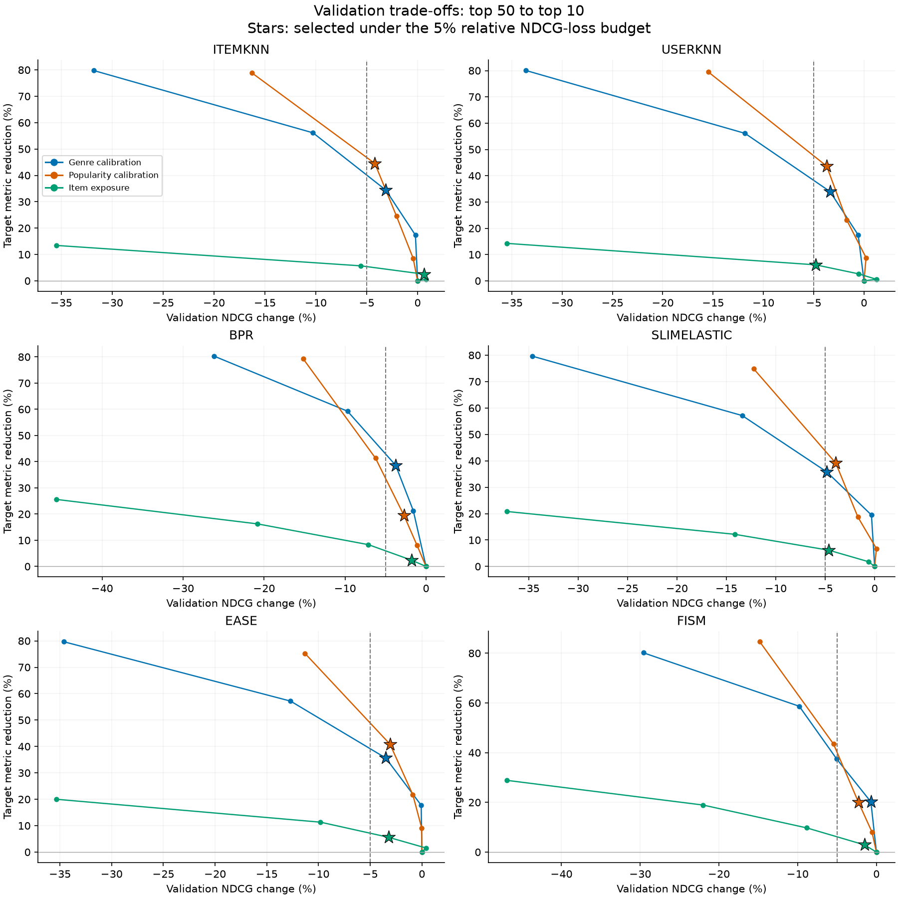</a></figure>

**Figure 9. Read the feasible side of the boundary.** The horizontal axis is relative NDCG change, so values to the right of −5% satisfy the budget. The vertical axis is reduction in the designated mismatch or inequality metric. Stars mark selected strengths; connecting lines join the tested discrete settings. Each target retains its own meaning, so a larger vertical reduction is comparable within a target rather than across all colors.

<!-- role: limitation -->
The five-percent limit is a relative change, not five NDCG points or a demonstrated threshold of user acceptability. Validation feasibility also gives no guarantee of the same loss on test. If a fixed choice loses more than five percent on test, the correct response is to report that outcome. Selecting again with test answers would convert measurement into another tuning stage.

### Read a trade-off as a choice between outcomes

<!-- role: definition -->
A setting is <strong>Pareto dominated</strong> when another tested setting is at least as good on both accuracy and the target, and strictly better on one. A set of undominated choices forms a <strong>Pareto frontier</strong> for those measured alternatives. This language helps identify wasteful operating points, but a finite strength grid reveals only the tested points; straight lines between them do not establish attainable intermediate lists.

<!-- role: reasoning -->
The project's constrained rule chooses one operating point from these possibilities. It expresses a priority: optimize the designated target after excluding excessive validation accuracy losses. A different budget can select another point without changing the algorithm's underlying formula. Neither the metric definitions nor the data alone determine how much accuracy should be exchanged for closer preference matching or broader exposure.

<!-- role: reasoning -->
Strength is not an effect-size scale. Doubling λ need not double the target improvement, because a greedy ranking changes through discrete item choices. The same λ can also produce different changes for two users whose candidate scores are separated differently. Validation measures the aggregate consequence of those choices, while subgroup analysis checks whether the aggregate hides concentrated costs.

<!-- role: method -->
Keep relative changes separate from absolute changes. EASE genre calibration changes NDCG from 0.404872 to 0.377624: an absolute drop of about 0.027248 and a relative loss of 6.73%. EASE exposure changes Gini from 0.950662 to 0.889884: about 0.060778 index units or 6.39% relative reduction. The bar heights summarize ratios against each original value, rather than quantities on a shared utility scale.

<!-- role: limitation -->
The zero-strength control is always a meaningful candidate when the original target is available. If no positive setting passes the budget, retaining zero says the tested grid found no permitted change. It does not prove that every smaller positive strength, alternative pool or different reranker would fail. A bounded follow-up can refine one such uncertainty while keeping model fits, profiles, masks and the validation rule fixed.

### What the tuned-model comparison shows

**Table 3. Calibration and exposure on the six tuned models. Loss is relative test NDCG loss; each method uses its own validation-selected strength.**

| Model | Original NDCG | Genre λ / loss | Popularity λ / loss | Exposure λ / loss |
| --- | ---: | ---: | ---: | ---: |
| ItemKNN | 0.363396 | 0.50 / 5.80% | 0.75 / 4.32% | 0.50 / 0.12% |
| UserKNN | 0.368776 | 0.50 / 5.27% | 0.75 / 4.00% | 0.75 / 6.45% |
| BPR | 0.373665 | 0.50 / 6.23% | 0.50 / 2.92% | 0.25 / 2.46% |
| SLIMElastic | 0.403266 | 0.50 / 5.54% | 0.75 / 3.79% | 0.50 / 4.49% |
| EASE | 0.404872 | 0.50 / 6.73% | 0.75 / 4.31% | 0.50 / 5.60% |
| FISM | 0.372549 | 0.25 / 0.14% | 0.50 / 3.30% | 0.25 / 1.77% |

<!-- role: evidence -->
Genre mismatch falls by 19.22–38.35%, popularity deviation by 18.41–42.44% and exposure Gini by 2.69–7.30%. Seven of these eighteen fixed choices exceed five-percent NDCG loss on test. These percentages describe different targets; they cannot be added or ranked as a common quantity of user benefit.

<figure class="report-figure" id="figure-10"><a href="figures/test-effects.png">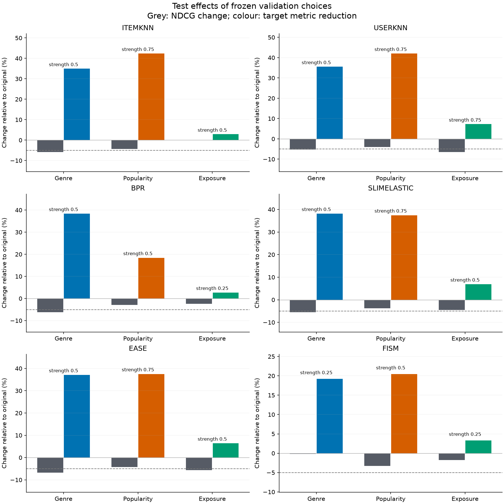</a></figure>

**Figure 10. Improving the target often has an accuracy cost.** Grey bars show test NDCG change; colored bars show reduction in the designated target. EASE genre calibration reduces mismatch by 37.09% while losing 6.73% NDCG. FISM genre calibration reduces mismatch by 19.22% at a much smaller 0.14% loss. The dashed −5% line is a reference to the validation budget, not a rule for choosing again on test.

<!-- role: interpretation -->
The cost depends on the base model and the available alternatives. A reranker can make a large category adjustment cheaply when several almost equally scored movies serve different categories. It can face a larger cost when its desired categories compete with much stronger relevance scores. The results are consistent with that mechanism, but they do not isolate a causal explanation for every model difference.

<!-- role: evidence -->
ItemKNN exposure reranking illustrates why reach and equality need separate measurements. NDCG changes from 0.363396 to 0.362948, about 0.12% loss. Coverage rises from 11.59% to 25.98%, while Gini falls from 0.966588 to 0.938365. Many more movies appear, but visibility remains highly concentrated.

<!-- role: evidence -->
UserKNN exposure obtains the largest relative Gini reduction, 7.30%, with 6.45% NDCG loss. Across all six models, exposure-reranked Gini remains approximately 0.881–0.938. The method reduces concentration under the chosen metric while leaving substantial inequality. Calling that outcome complete item fairness would exceed the measurement.

### A smaller user gap can still mean worse recommendations

<figure class="report-figure" id="figure-11"><a href="figures/reranking-groups.png">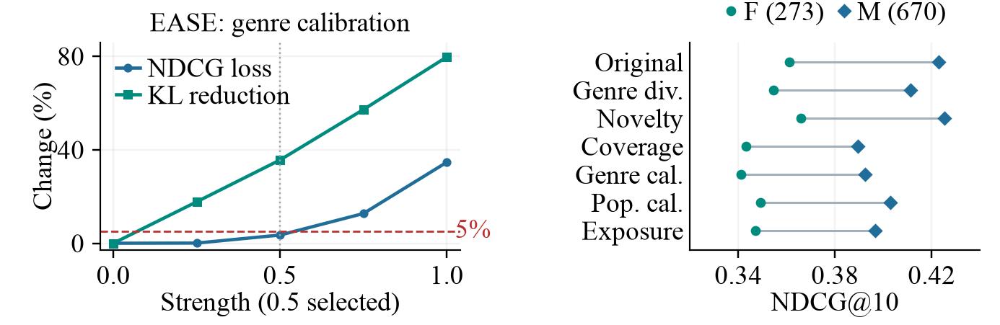</a></figure>

**Figure 11. Check absolute group quality alongside the gap.** The left panel follows EASE's genre-calibration validation sweep; the selected setting meets the validation budget. The right panel compares recorded F/M test NDCG means before and after all six interventions, including diversification. The lower-performing group does not automatically benefit when the two group means move closer.

<!-- role: evidence -->
For EASE exposure reranking, mean F-user NDCG falls from about 0.361 to 0.347 and mean M-user NDCG from 0.423 to 0.397. The gap narrows because the higher-scoring group loses more. This supports a specific description of the redistribution; it does not establish an improvement in the lower-performing group's recommendation quality.

<!-- role: interpretation -->
An evaluation should ask three questions together: did the designated target improve, what happened to accuracy, and who experienced the change? A cohort mean can hide unequal effects, while a gap can hide falling quality in both groups. This is why subgroup diagnostics complement your overall trade-off measurements.

<!-- role: limitation -->
The six-model study uses one seed and one repeatedly inspected split. Its curves and bars are descriptive comparisons without confidence intervals. They establish observed changes under the stated candidates, settings and metrics. Robustness across retraining, new splits, larger candidate pools and different activity groups remains a separate empirical question.
<!-- ownership: jacek:end -->

<!-- ownership: shared:start -->
## 8. Hybrids: combine different kinds of information

<!-- role: opening -->
A hybrid combines models to exploit complementary information. The combination can happen at several levels: numerical scores, retrieved candidates, feature vectors or fitted representations. The mechanism determines what must be controlled in an experiment. Hybrids can use different objectives and information.

### Weighted prediction with out-of-fold features

<!-- role: method -->
The weighted hybrid scores an item with an intercept plus a weighted sum of six component scores. <strong>Ridge regression</strong> learns those weights by minimizing squared error on observed raw ratings, with an L2 penalty on coefficient magnitude. The intercept is unpenalized, and the coefficients can be positive or negative. Its training objective predicts rating values; validation NDCG chooses the regression penalty for the eventual ranking task.

<!-- role: definition -->
<strong>Out-of-fold prediction</strong> means predicting an example with a model fitted without that example's fold. The project divides only the outer training interactions into five user-stratified folds. Each component fits on four folds and predicts observed interactions in the fifth. Repeated user–item pairs stay together, and users retain training support. Concatenating these predictions gives 60,734 rows of component features paired with raw 1–5 training ratings.

<!-- role: reasoning -->
Using in-sample component scores would let the combiner learn from how well each component already fits its own answers. Out-of-fold features better represent the prediction behavior the combiner encounters on unseen interactions. Fold models use fixed training budgets; their held-out-fold target labels also do not select their checkpoint. Outer validation remains the separate source for choosing the Ridge penalty.

<!-- role: method -->
Before fusion, each component is <strong>z-score standardized</strong> over a user's eligible candidates: subtract its mean and divide by its standard deviation. A constant vector becomes zero. This prevents arbitrary raw score scales from determining a component's influence. It differs from the min-max scaling inside a reranker: the weighted combiner is fitted to standardized full-candidate scores.

<!-- role: reasoning -->
Standardization uses predictions and candidate membership, not test ratings. Test-history masking can change its candidate-relative mean and variance, so the transform is recomputed on eligible test candidates. That is part of the specified scoring procedure. The resulting weights retain meaning only alongside this transform; applying them directly to raw component scores would construct another hybrid.

<!-- role: evidence -->
The selected Ridge penalty is 30,000. The weighted hybrid reaches test NDCG 0.409095 against 0.401882 for its matched SLIM component, about 1.80% higher. On validation, the combination does not lead that component. This supports a measured test advantage in the experiment, rather than a claim that regression fusion always improves the strongest component.

### What the other hybrid designs transfer

**Table 4. Hybrid mechanisms and the control each needs.**

| Design | Information transferred | Main decision or trade-off |
| --- | --- | --- |
| Switching | A choice of one whole model per user | Routing can exploit support differences without calibrating scores. |
| Cascade | A candidate shortlist for another scorer | Retrieval can make relevant items unreachable. |
| Feature combination | Several feature vectors into a learned scorer | Extra capacity can learn interactions or overfit them. |
| Feature augmentation | Inferred values added to a receiver's inputs | Receiver training must distinguish inferred inputs from observed targets. |
| Meta-level | A learned representation used by another model | Improvement depends on whether the representation helps that model's similarity rule. |

<!-- role: method -->
Switching selects UserKNN or BPR using training-derived features such as history length and neighborhood support. A validation grid chooses routing thresholds, including constant-model controls. Because it chooses an entire score row, it avoids numerical score fusion. Its warm-item experiment includes 1,615 training-supported movies and 19,588 test positives, so the control must use that same scope.

<!-- role: method -->
The cascade uses ItemKNN to retrieve candidates and BPR to order them. It selects component settings and shortlist depth jointly by final validation NDCG. Joint selection matters because the best standalone retriever and scorer need not be the best pair. History masking occurs before retrieval, and relevant items missed by the shortlist remain in the evaluation denominator. Reported candidate fractions indicate scoring volume, rather than measured speed gains.

<!-- role: method -->
Feature combination concatenates frozen BPR user and item vectors and trains a multilayer perceptron (MLP) with two hidden layers and a pairwise ranking loss. Its ReLU activations clip negative values to zero. A metadata-feature variant supplies a different input control. A residual variant instead adds an MLP correction to the frozen BPR score. Its final layer starts at zero, making its initial prediction exactly the BPR control and allowing validation to retain that option.

<!-- role: method -->
Feature augmentation adds normalized positive UserKNN predictions to previously unobserved entries in EASE or SLIM's input matrix. Observed binary targets remain unchanged, and the receiving model is refitted. Since augmented input X differs from target R, EASE solves the constrained objective <code>||R−XB||² + λ||B||²</code>. Treating inferred entries as observed targets would change the learning problem. A matched unaugmented receiver isolates the augmentation effect.

<!-- role: method -->
The meta-level hybrid transfers BPR user vectors into a neighborhood model. Positive cosine similarities between those vectors determine neighbors; self-similarity is excluded. Neighbor weights applied to the training interaction matrix produce item scores. An interaction-cosine control changes the similarity representation while preserving the neighborhood mechanism.

### Controlled results and component contribution

<figure class="report-figure" id="figure-12"><a href="figures/hybrid-comparisons.svg">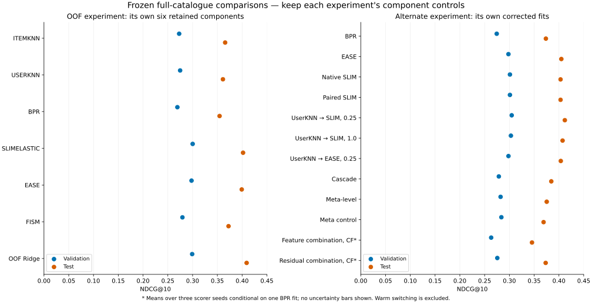</a></figure>

**Figure 12. Read each experiment beside its own control.** The left panel compares the Ridge hybrid with its retained components. The right compares the alternative hybrids. Weak UserKNN-to-SLIM augmentation reaches test NDCG 0.411904 against its paired receiver's 0.403254, about 2.15% higher. Full catalogue scope is common to these panels; warm switching is evaluated separately.

<!-- role: evidence -->
More transferred information does not consistently help. Stronger SLIM augmentation yields a smaller gain, and weak EASE augmentation reaches 0.403747 against the receiver's 0.404872. Plain feature combination averages about 0.345623 across three scorer seeds; the residual variant averages 0.373233 against its BPR control's 0.373665. These seeds vary the added scorer while keeping the underlying BPR fit fixed.

<!-- role: evidence -->
Switching reaches 0.371960 against matching warm UserKNN at 0.368763. The selected cascade reaches 0.384593, and the BPR-vector meta-level model reaches 0.375364 against its interaction-cosine control at 0.369014. The meta-level ordering reverses between validation and test. That reversal is an observed outcome, not a reason to redefine selection after seeing test scores.

<!-- role: definition -->
An <strong>ablation</strong> removes or replaces part of a system to examine its contribution. A frozen component removal sets one Ridge coefficient to zero while keeping the others fixed. A refitted removal relearns the remaining coefficients on the same out-of-fold rows at the same penalty. The first measures dependence of this fitted combination; the second asks how much the other components can compensate.

<figure class="report-figure" id="figure-13"><a href="figures/coefficient-ablation.svg">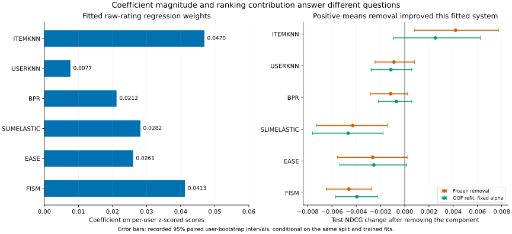</a></figure>

**Figure 13. Weight magnitude and ranking utility differ.** ItemKNN has the largest coefficient, about 0.046954, yet removing it improves test NDCG by 0.004194 without refitting and 0.002524 with refitting. Frozen FISM removal instead lowers NDCG by 0.004608. Positive values in the removal panel mean that the removal helped.

<!-- role: reasoning -->
Correlated component scores, standardized feature units and the squared-rating-error objective explain why coefficients are not contribution percentages. The ranking outcome depends on order changes near the top, rather than only on regression fit. A large weight can accompany a harmful marginal effect in one fitted system.

<!-- role: limitation -->
The error bars are paired user-bootstrap intervals. A <strong>bootstrap</strong> repeatedly resamples users, keeping the competing predictions paired for each sampled user, then recalculates the difference. These intervals quantify uncertainty conditional on the split and fitted models. They omit new training, new split and selection variability. Favorable test ablations can explain behavior, but choosing a new reduced model requires development-data selection.

## 9. Why hybrid and reranking order can matter

<!-- role: opening -->
Combining models and reranking their outputs are different operations, so changing their order can change the final list. The order experiment fixes the component fits, profiles, coefficients, list length and candidate policy. This isolates the consequence of placing the same intervention before or after combination.

### A controlled comparison for the weighted hybrid

<!-- role: method -->
Both weighted paths standardize scores over the full eligible catalogue and use the same top-fifty pool chosen by the unchanged hybrid. In the <strong>pre</strong> path, each component is reranked before frozen Ridge fusion. In the <strong>post</strong> path, Ridge first combines the original component scores and one reranker then changes the hybrid list. Positives outside the pool remain in the relevance denominator.

<figure class="report-figure" id="figure-14"><a href="figures/pipeline-orders.svg">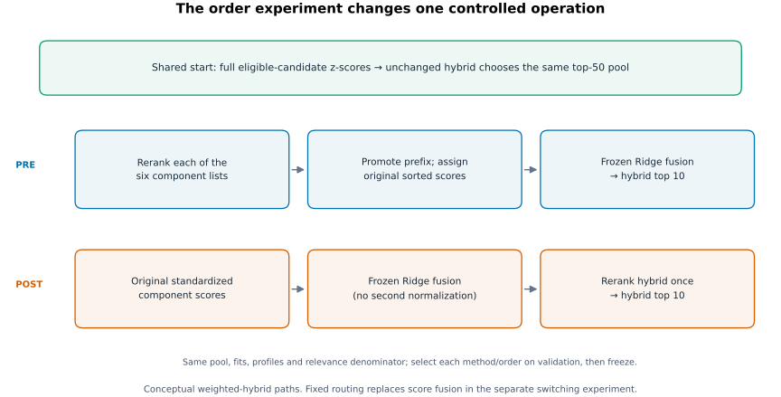</a></figure>

**Figure 14. A reranked list needs a score interpretation before fusion.** The pre path promotes the selected component prefix, appends unselected items in their original order and assigns the component's original descending standardized values to those positions. This preserves the score values while changing which items receive them. The post path changes the already combined ranking.

<!-- role: example -->
With scores {a:3,b:2,c:1} and reranked prefix [c], the pre conversion becomes {c:3,a:2,b:1}. It preserves the <strong>multiset</strong> of values—the values including their repetition counts. It does not replace them with reciprocal ranks. Ridge then uses its existing weights without another normalization. Equal score values can make some promoted order changes invisible to the combiner.

<!-- role: method -->
Each method/order selects one validation strength under the same five-percent budget. Pre uses that strength for all six components, avoiding six additional independent choices. Zero strength reproduces the original hybrid in both paths. These controls make the result about one specified conversion and order policy, rather than every possible interpretation of pre-reranking.

**Table 5. Weighted-hybrid test outcomes. Its original NDCG is 0.409095.**

| Target | Pre NDCG loss | Pre target reduction | Post NDCG loss | Post target reduction |
| --- | ---: | ---: | ---: | ---: |
| Genre mismatch | 5.45% | 27.41% | 7.18% | 37.15% |
| Popularity deviation | 3.35% | 31.68% | 4.26% | 37.85% |
| Exposure Gini | 2.39% | 3.95% | 5.04% | 5.86% |

<!-- role: interpretation -->
Post-reranking produces the greater reduction for every designated target, with a larger NDCG cost. The intervention acts directly on the final hybrid list, whereas fusion can partly counteract separate component changes. This interpretation is conditional on the fixed pools and score-preserving conversion. It provides no universal dominance result across other pre-processing rules.

### Fixed routing versus shared cohort state

<!-- role: reasoning -->
For switching, user-local calibration gives identical lists before and after fixed routing when scores, pools, profiles and strength match. The route chooses the same component for the user, so the same deterministic local operation sees the same input. Such operations <strong>commute</strong>: their order gives the same result under those conditions.

<!-- role: evidence -->
The experiment establishes exact list equality at every tested validation strength and at the selected test strengths, which is stronger than equality of mean NDCG. The route sends 733 users to UserKNN and 210 to BPR. Its genre and popularity outcomes therefore coincide for the two orders.

<!-- role: reasoning -->
Exposure allocation depends on other users, so the same argument fails. Pre-reranking maintains separate counters over all potential users for each component, including component lists that routing later discards. Post-reranking maintains one counter over the final mixed cohort. The two policies generate different exposure histories even for a user whose own scores are unchanged.

<!-- role: evidence -->
Exposure lists differ for 747 test users. Pre loses 2.08% NDCG while reducing Gini by 4.64%; post loses 4.14% while reducing Gini by 5.27%. The result connects an aggregate trade-off to a specific state policy. It also shows why treating a cohort-dependent reranker as an independent transformation of each user would misdescribe the algorithm.

## 10. Diversification: three distinct goals

<!-- role: opening -->
Gabriel's diversification methods promote genre variety, novelty or catalogue coverage. Each uses the same relevance term and strength interface as the other rerankers, but adds one designated bonus. They are alternatives with different targets, rather than one algorithm that simultaneously optimizes all beyond-accuracy outcomes.

<!-- role: method -->
Genre diversification adds the mean Jaccard distance between a candidate and the selected prefix. Its first-position bonus is zero because there is no earlier item to compare against. Later choices favor items different from what is already selected. Historical genre proportions do not enter this objective, which distinguishes variety from your genre calibration.

<!-- role: method -->
Novelty diversification adds training self-information, min-max normalized within the user's pool. Candidate novelty is fixed for that user and pool, whereas a genre-variety bonus changes as the prefix grows. Equal novelty values become zero after normalization. A head-heavy user can therefore receive a novel list that matches their history less closely.

<!-- role: method -->
Coverage diversification uses bonus one for an item not yet recommended anywhere in the current cohort call, otherwise zero. It visits rank rounds and sorted external user IDs, resetting its covered-item set each call. This is another cohort-dependent method, but it tracks first appearance rather than discounted repeated exposure. A new movie helps coverage even if many other appearances remain concentrated.

<figure class="report-figure" id="figure-15"><a href="figures/diversification-validation-tradeoffs.png">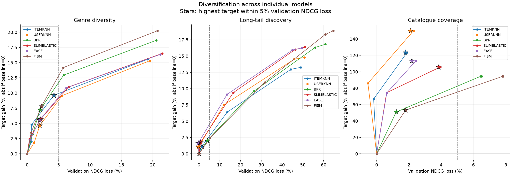</a></figure>

**Figure 15. The horizontal sign differs from Figure 9.** Here the axis is NDCG loss, so points to the left of +5% satisfy the budget. Stars mark the best target within that feasible set. The panels show different targets and use different ranges. Lines join discrete strengths; they do not demonstrate a continuous optimal frontier.

<!-- role: evidence -->
Tuned FISM keeps novelty strength at zero. Its first positive strength, 0.25, loses about 5.45% validation NDCG, and every larger tested strength is also infeasible. Zero is a valid outcome of the constrained selection rule. A finer grid below 0.25 might locate a feasible intervention, but these results do not establish that it exists.

<figure class="report-figure" id="figure-16"><a href="figures/diversification-test-effects.png">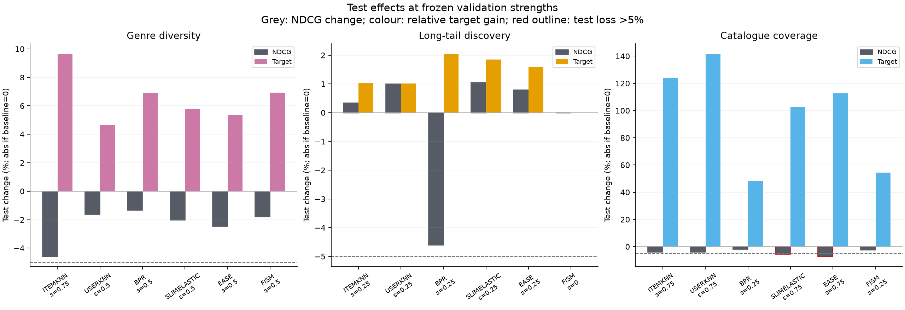</a></figure>

**Figure 16. Diversification has model-dependent costs.** Genre ILD rises by 4.67–9.66%, and catalogue coverage by 48.25–141.77%. Novelty gains range from zero for unchanged FISM to 2.05%. Grey bars show NDCG changes; colored bars show gains in that panel's target. Different target scales cannot be treated as equal amounts of benefit.

<!-- role: evidence -->
Two of eighteen diversification choices exceed five-percent test NDCG loss: SLIM and EASE coverage. Combined with the calibration/exposure study, nine of 36 choices exceed that reference on test. Some novelty choices improve both their target and accuracy: EASE gains about 1.58% self-information and 0.80% NDCG. Higher beyond-accuracy performance therefore does not imply an unavoidable accuracy penalty at every operating point.

<!-- role: interpretation -->
UserKNN coverage rises from about 10.11% to 24.44% in this study. That is roughly 141.77% relative gain but only 14.33 percentage points. A large relative bar is easier to obtain from a small baseline. The resulting catalogue share remains far below complete coverage and says nothing by itself about equal exposure or user-group quality.

<!-- role: limitation -->
All three methods act within the supplied candidate pools. Novelty cannot introduce an unseen tail movie if every model has excluded it from the top fifty. Genre variety can be constrained by similar candidate genres, and coverage can saturate when users share a narrow pool. Broader retrieval and reranking strength therefore address different bottlenecks.

## 11. Group analysis: who and what receives the result?

<!-- role: opening -->
Overall averages can hide systematic differences between users and items. Victor's group-analysis implementation recomputes the shared metrics within defined cohorts and reports how recommendations, hits and exposure are distributed across item groups. It provides diagnostics for understanding an intervention. The user-fairness reranker itself remains unimplemented.

### User groups and their denominators

<!-- role: method -->
Activity groups divide users by training-history counts using one-third and two-third quantiles. The current boundaries are 26 and 69: low is at most 26, medium is above 26 and at most 69, and high is above 69. Their sizes are 321, 310 and 312. Equal counts remain together, so a tercile rule need not create exactly equal groups.

<!-- role: method -->
Recorded-gender groups contain 273 F and 670 M users, with an explicit unknown group when required. Genre-preference cohorts use the user's three largest training genre-profile entries. A user can belong to several genre cohorts, so their counts overlap. These groups answer different questions about data availability, recorded attributes and observed taste.

**Table 6. EASE test NDCG by training activity, illustrating why a mean needs context.**

| Cohort | Users | Original | Genre calibration | Exposure reranking |
| --- | ---: | ---: | ---: | ---: |
| Low activity | 321 | 0.292260 | 0.258763 | 0.272368 |
| Medium activity | 310 | 0.328824 | 0.313383 | 0.303654 |
| High activity | 312 | 0.596292 | 0.563742 | 0.573300 |

<!-- role: interpretation -->
High-activity users receive much higher NDCG in this comparison. They have richer training histories and a different held-out relevance profile; the table alone does not isolate which factor causes the difference. Both interventions reduce NDCG in every activity cohort, while the sizes of the losses differ. A successful target reduction at the population level therefore does not establish uniform user benefit.

<!-- role: method -->
The report flags cohorts smaller than thirty but still calculates their measurements when possible. A flag warns about limited evidence; it does not suppress estimates or make them reliable. Empty cohorts retain explicit counts and unavailable values. Any explanation of a group mean should identify its population before interpreting a difference.

### Item quality and audience quality are different measurements

<!-- role: definition -->
An item group's <strong>conditional precision</strong> divides relevant recommendations from that group by all recommendations from that group. Its recall divides group hits by held-out relevant items in that group. These are pooled item-occurrence calculations, unlike the macro means of per-user precision and recall. Their denominators make the questions precise.

<!-- role: example -->
EASE originally recommends only five tail-item slots across all users, with two hits. Tail precision is therefore 40%, but tail recall is only 2/3,891, about 0.0514%. After exposure reranking there are 186 tail slots and 26 hits: precision falls to about 13.98%, while recall rises to about 0.6682%. Lower conditional precision accompanies many more recovered tail interactions.

<!-- role: interpretation -->
The original 40% estimate is based on just five recommendations and cannot establish broad success for tail movies. The changed precision/recall pair instead describes a coverage–selectivity trade-off: a larger, less accurate set of tail recommendations retrieves more tail positives. Reporting only one denominator would obscure this behavior.

<!-- role: definition -->
An item group's <strong>audience accuracy</strong> describes the whole-list quality of the users receiving that group's items. Each user's metric contributes once per occurrence of the group's movies in their list. It answers “What recommendation quality do these recipients experience?” rather than “How often are this group's items hits?” The implementation also supplies analogous audience summaries for available per-user beyond-accuracy measures.

<!-- role: reasoning -->
Item-genre groups count all memberships of a multi-genre movie. An Action/Comedy recommendation contributes once to each group, so genre membership shares need not describe disjoint recommendation slots. Calibration instead divides one movie's mass across its genres. Both conventions are coherent for their respective questions; combining their numbers requires preserving that denominator distinction.

<!-- ownership: shared:end -->
